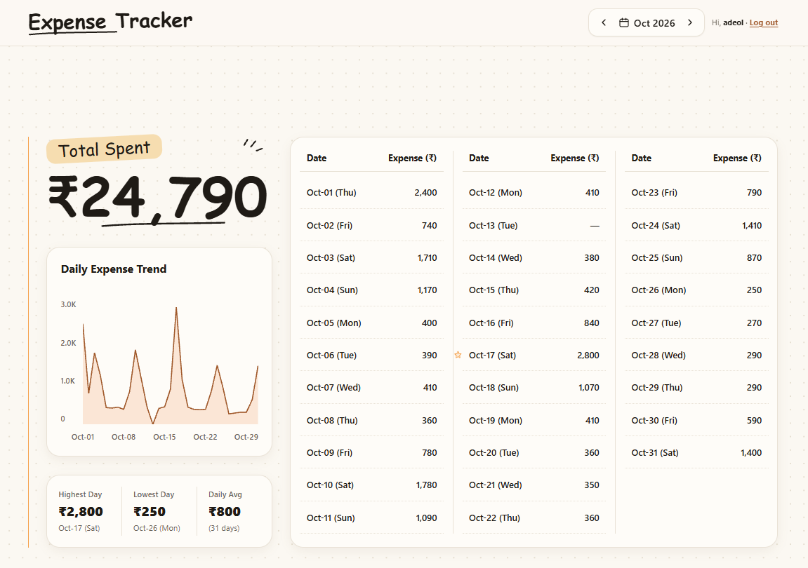

# Expense Tracker

A simple app to write down what you spend each day and see where your money goes.



## What you can do

- **Sign up and log in** so your expenses stay private.
- **See the whole month at once**, with what you spent each day.
- **Add, change or delete expenses** by clicking on a day.
- **See your monthly total**, your highest and lowest spending days, and your daily average.
- **Follow your spending on a chart** across the month.
- **Look back at past months** with the arrows next to the month name.

## How to run it on your computer

You need [Node.js](https://nodejs.org) installed. The app has two parts that both need to be running: the **server** (saves your data) and the **app** (what you see).

### 1. Start the server

The server lives in its own repo: [track-expense-backend](https://github.com/anuragDeol/track-expense-backend). Download it:

```
git clone https://github.com/anuragDeol/track-expense-backend.git
cd track-expense-backend
```

Inside that folder, create a file named `.env` with:

```
PORT=7000
MONGO_URI=your MongoDB connection link
SESSION_SECRET=any long random text
CLIENT_URL=http://localhost:3000
```

Then run:

```
npm install
npm start
```

### 2. Start the app

Inside this project's folder, create a file named `.env` with:

```
REACT_APP_API_URL=http://localhost:7000
```

Then run:

```
npm install
npm start
```

The app opens in your browser at http://localhost:3000. Create an account and start adding expenses.

---

## For developers

### Tech stack

- **Frontend:** React 19, Tailwind CSS 3, built with Create React App (`react-scripts`).
- **Backend** ([track-expense-backend](https://github.com/anuragDeol/track-expense-backend)): Node.js, Express 5, MongoDB with Mongoose.
- **Auth:** session cookies (`express-session` stored in MongoDB via `connect-mongo`), passwords hashed with `bcryptjs`.

### Project structure (`src/`)

```
api/api.js          All backend calls in one place
hooks/useAuth.js    Login state: check session, login, register, logout
hooks/useExpenses   Loads expenses and keeps them in sync on add / edit / delete
utils.js            Date keys, money formatting, month building, stats, chart path
components/         UI pieces (Dashboard, TrendCard, DailyTable, DayModal, ...)
```

`App` checks the session, then shows either `AuthScreen` or `Dashboard`. `Dashboard` builds one row per day of the selected month and passes it to the cards, table and day popup.

### How data works

- Amounts are **whole rupees (INR)** in the UI and **paise** (×100) on the server; `api.js` converts both ways.
- Each expense belongs to a day, stored as `"YYYY-MM-DD"`.
- Every request sends the session cookie (`credentials: 'include'`). A `401` logs the user out.
- Future days can't have expenses; stats and the chart only count days up to today.

### API endpoints

| Method | Path | Purpose |
| --- | --- | --- |
| GET | `/api/auth/me` | Current user (from session) |
| POST | `/api/auth/register` | Create account |
| POST | `/api/auth/login` | Log in |
| POST | `/api/auth/logout` | Log out |
| GET | `/api/expense/get-expenses` | All of the user's expenses |
| POST | `/api/expense/add-expense` | Add one expense |
| PATCH | `/api/expense/update-expense/:id` | Change an amount |
| DELETE | `/api/expense/delete-expense/:id` | Delete an expense |

### Scripts

| Command | What it does |
| --- | --- |
| `npm start` | Dev server at http://localhost:3000 |
| `npm run build` | Production build into `build/` |
| `npm test` | Run tests |
